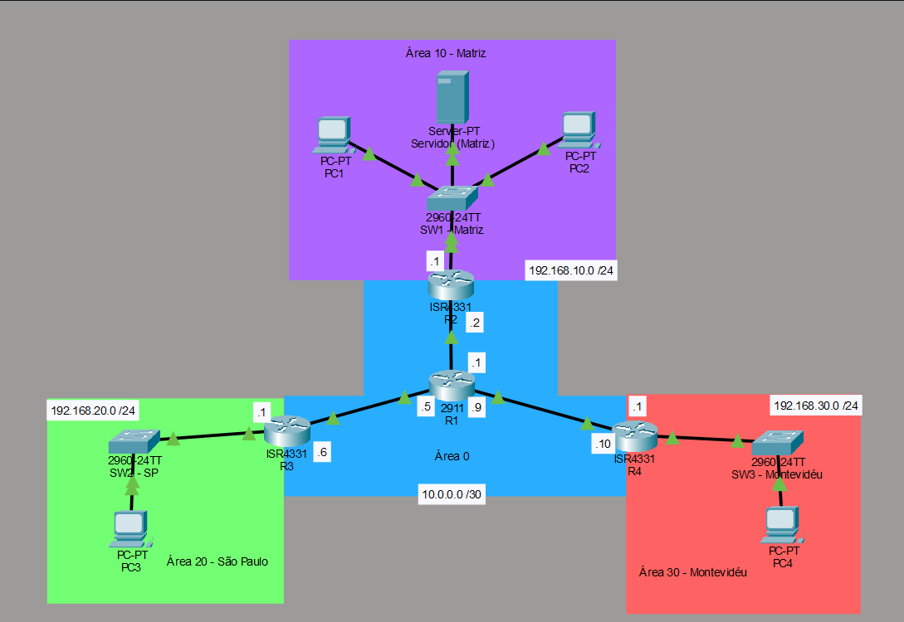
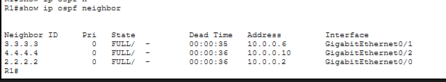
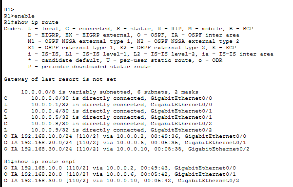
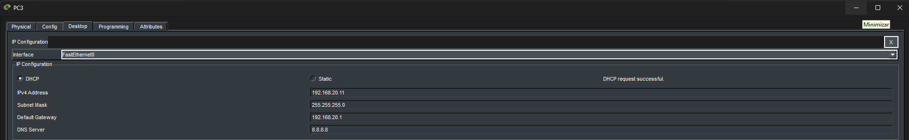

# Projeto 4 — OSPF Multiárea: Matriz e Filiais

## Visão geral

Laboratório desenvolvido no Cisco Packet Tracer para implementar uma infraestrutura de rede corporativa com matriz e filiais, utilizando OSPF multiárea e DHCP centralizado.

O projeto aborda configuração de roteamento dinâmico, segmentação lógica de redes, configuração de enlaces entre roteadores, distribuição automática de endereços IP e validação da conectividade entre diferentes redes LAN.

## Objetivos do projeto

- Implementar roteamento dinâmico com OSPF multiárea.
- Configurar o backbone OSPF na Área 0.
- Separar as redes LAN da matriz e das filiais em áreas distintas.
- Configurar Router IDs e anunciar as redes necessárias no OSPF.
- Configurar interfaces LAN como passivas.
- Configurar os enlaces WAN Ethernet com o tipo de rede OSPF `POINT-TO-POINT`.
- Implementar um servidor DHCP centralizado.
- Configurar DHCP Relay para atender às redes remotas.
- Validar vizinhanças OSPF, rotas aprendidas, atribuição de endereços IP e conectividade entre as redes.

## Topologia da rede

A infraestrutura é composta por quatro roteadores, três switches, quatro PCs e um servidor.

### Organização das áreas OSPF

| Roteador | Função | Área da LAN |
|---|---|---|
| R1 | Roteador central e backbone | Área 0 |
| R2 | Roteador da matriz | Área 10 |
| R3 | Roteador da filial de São Paulo | Área 20 |
| R4 | Roteador da filial de Montevidéu | Área 30 |

Os enlaces WAN entre os roteadores pertencem à Área 0. Os roteadores R2, R3 e R4 conectam suas respectivas LANs ao backbone e atuam como roteadores de borda de área (ABRs — *Area Border Routers*).

## Plano de endereçamento IPv4

### Enlaces WAN

| Enlace | Rede | Endereço IP |
|---|---|---|
| R1–R2 | `10.0.0.0/30` | R1: `10.0.0.1` — R2: `10.0.0.2` |
| R1–R3 | `10.0.0.4/30` | R1: `10.0.0.5` — R3: `10.0.0.6` |
| R1–R4 | `10.0.0.8/30` | R1: `10.0.0.9` — R4: `10.0.0.10` |

Máscara das redes WAN: `255.255.255.252` (`/30`).

### Redes LAN

| Localidade | Rede | Gateway padrão | Área OSPF |
|---|---|---|---|
| Matriz | `192.168.10.0/24` | `192.168.10.1` | 10 |
| São Paulo | `192.168.20.0/24` | `192.168.20.1` | 20 |
| Montevidéu | `192.168.30.0/24` | `192.168.30.1` | 30 |

Máscara das redes LAN: `255.255.255.0` (`/24`).

O servidor DHCP está localizado na rede da matriz, com o endereço IP estático `192.168.10.10`.

## Implementação do OSPF

Foi utilizado o processo OSPF de número 10 nos roteadores. As interfaces necessárias foram associadas às áreas correspondentes por meio do comando `network`, e os Router IDs foram definidos individualmente.

O backbone utiliza a Área 0, enquanto as LANs da matriz e das filiais estão distribuídas nas Áreas 10, 20 e 30.

### Interfaces LAN passivas

As interfaces conectadas às LANs foram configuradas como passivas no OSPF.

Essa configuração permite que as redes continuem sendo anunciadas pelo OSPF, sem que essas interfaces enviem mensagens Hello ou estabeleçam adjacências OSPF com dispositivos conectados às LANs.

### Enlaces WAN POINT-TO-POINT

Os enlaces WAN Ethernet dedicados à conexão entre dois roteadores foram configurados com o tipo de rede OSPF `POINT-TO-POINT` nas duas extremidades.

Essa configuração elimina a eleição de DR (*Designated Router*) e BDR (*Backup Designated Router*) nesses segmentos.

### Validação das vizinhanças OSPF

A formação das adjacências foi verificada com o comando `show ip ospf neighbor`. Os vizinhos apresentaram o estado `FULL`, indicando que as adjacências estavam completas.

### Validação das rotas OSPF

As rotas aprendidas foram verificadas com o comando `show ip route ospf`.

Durante a implementação, identifiquei que as vizinhanças estavam estabelecidas, mas as redes LAN ainda não apareciam na tabela de roteamento OSPF. Após anunciar as redes LAN nas respectivas áreas, o roteador central passou a aprender as rotas necessárias para alcançar a matriz e as filiais.

## DHCP centralizado

Foi configurado um servidor DHCP na matriz, com endereço IP estático `192.168.10.10` e gateway padrão `192.168.10.1`.

O serviço foi configurado para distribuir endereços IP às redes atendidas.

Nas interfaces LAN dos roteadores remotos, foi utilizado o comando `ip helper-address` para encaminhar as solicitações DHCP ao servidor central. O roteamento OSPF fornece a conectividade IP necessária para que essas solicitações encaminhadas cheguem ao servidor.

### Validação do DHCP

Os PCs foram configurados para obter endereços IP automaticamente. A distribuição de endereços por DHCP foi testada nas redes da matriz, de São Paulo e de Montevidéu.

## Troubleshooting e aprendizados

Durante a implementação e a validação da infraestrutura, foram identificados e corrigidos problemas de configuração.

- **Rotas LAN ausentes:** as vizinhanças OSPF estavam estabelecidas, mas as redes LAN não haviam sido anunciadas inicialmente. A configuração foi ajustada para incluir as redes nas respectivas áreas.
- **Gateway padrão incorreto:** um PC apresentava problemas de conectividade devido à configuração incorreta do gateway. Após a correção, os testes de comunicação foram concluídos com sucesso.
- **Tipo de rede OSPF:** analisei o comportamento padrão `BROADCAST` das interfaces Ethernet e configurei o tipo `POINT-TO-POINT` nos enlaces entre roteadores.
- **DHCP entre sub-redes:** configurei DHCP Relay para encaminhar as solicitações das filiais ao servidor DHCP centralizado.

Essas etapas reforçaram conceitos de roteamento dinâmico, segmentação lógica, diagnóstico de conectividade e integração de serviços de infraestrutura.

## Testes realizados

- Verificação do estado das interfaces.
- Testes de conectividade entre os roteadores.
- Verificação das vizinhanças com `show ip ospf neighbor`.
- Verificação das interfaces OSPF com `show ip ospf interface`.
- Verificação das interfaces participantes do OSPF com `show ip ospf interface brief`.
- Verificação das rotas aprendidas com `show ip route ospf`.
- Testes de ping entre dispositivos de diferentes LANs.
- Testes de atribuição automática de endereços IP via DHCP em todas as redes atendidas.

**Resultado:** os vizinhos OSPF foram estabelecidos, as rotas necessárias foram aprendidas, os PCs obtiveram endereços por DHCP e os testes de conectividade foram concluídos com sucesso.

## Tecnologias e conceitos

- Cisco Packet Tracer
- Cisco IOS
- OSPFv2 multiárea
- IPv4 e subnetting
- Redes Ethernet e enlaces WAN `/30`
- Router IDs e adjacências OSPF
- Interfaces passivas
- OSPF `POINT-TO-POINT`
- DHCP
- DHCP Relay
- Troubleshooting de redes

## Estrutura do repositório

- **Laboratório Cisco Packet Tracer:** [`projeto-4-ospf.pkt`](projeto-4-ospf.pkt)
- **Documentação detalhada:** [`Projeto_4__OSPF_Multirea_Matriz_e_Filiais.pdf`](docs/Projeto_4__OSPF_Multirea_Matriz_e_Filiais.pdf)
- **Capturas de tela:** pasta [`screenshots/`](screenshots/)

## Considerações finais

Este projeto foi desenvolvido para consolidar conhecimentos práticos de roteamento dinâmico, segmentação de redes e serviços de infraestrutura. A implementação foi acompanhada de testes, troubleshooting e documentação das principais decisões técnicas.

O laboratório permite visualizar a comunicação entre diferentes áreas OSPF, a distribuição centralizada de endereços IP e a validação da conectividade entre redes corporativas.